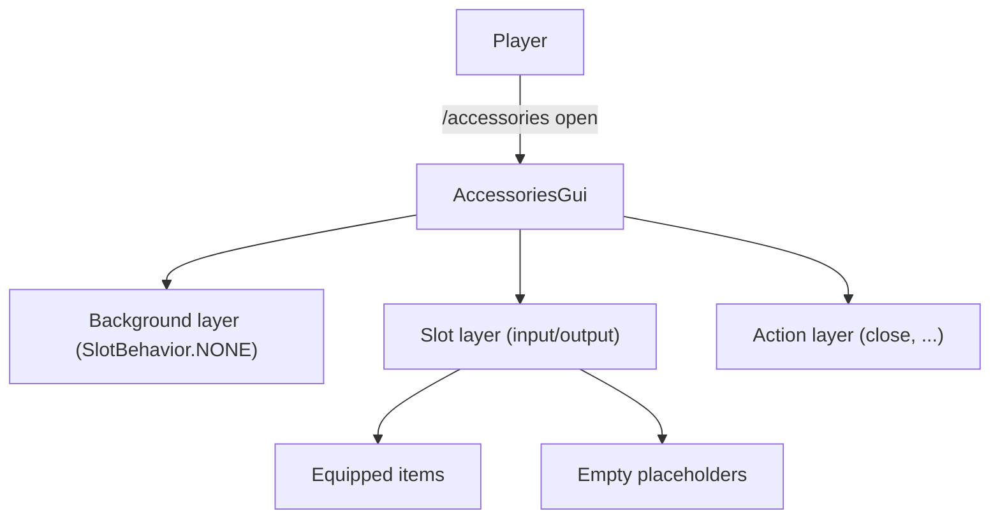

# Introduction

MC-MMO-Accessories is a PaperMC plugin that adds a slot-based accessory system on top of MMO Items. Players equip rings, necklaces, gloves, and belts in dedicated GUI slots; each slot accepts items whose MmoItems `types` list includes one of the slot's `accepted-types`.

The GUI is built on YueMi-MC-Libs' `GuiApi` (drag-and-drop, place / pickup / shift / drag behaviours, auto-refresh), and equip / unequip events flow through YueMi-Libs' `EventApi`. Storage is pluggable (PDC default; SQLite / MySQL / MongoDB available).

## Soft Dependencies

- **YueMi-MC-Libs** — `GuiApi` + `EventApi` (required for the GUI and listener path).
- **MMO Items** — item validation through `MmoItemsApi.getItemTypes` and skill binding lookup through `MmoItemsApi.getItemSkills`.
- **MMO Mechanics** — `MmoMechanicsApi.fireTrigger` carries `onEquip` / `onUnequip` into the trigger system; `castSkill` runs in-slot `onAttack` / `onRightClick` bindings.

## Default Slots

Slots are defined in `config.yml` under `slots:`. The shipped defaults:

| Slot | Max | Accepted Types |
| :--- | :--: | :--- |
| BELT | 1 | `BELT`, `WAIST` |
| GLOVES | 2 | `GLOVES`, `HAND` |
| RING | 2 | `RING` |
| NECKLACE | 1 | `NECKLACE`, `AMULET` |

A slot accepts an item if **any** of the item's MmoItems `types` is in its `accepted-types` list. Custom slot ids are supported by adding new entries under `slots:` in `config.yml`.

## Layer Model

## Commands

| Subcommand | Permission | Sender | Description |
| :--- | :--- | :--- | :--- |
| `/accessories open` | `accessories.command.open` | player | Open own GUI |
| `/accessories reload` | `accessories.command.reload` | any | Reload config |
| `/accessories list <player>` | `accessories.command.list` | any | List target's accessories |
| `/accessories view <player>` | `accessories.command.view` | player | Open target's GUI |
| `/accessories wipe <player>` | `accessories.command.wipe` | any | Wipe target's accessories |

GUI-bound commands (`open`, `view`) require a player sender; the rest accept console as well.

## Mechanics Integration

- `AccessoriesApiImpl.equipAccessory` / `unequipAccessory` call `MmoMechanicsApi.fireTrigger(uuid, "onEquip"/"onUnequip")` after every successful save. MMO Mechanics owns skill dispatch and the JSON5 `triggers: [...]` declarations.
- `AccessoryInteractionListener` (subscribed via YueMiLibs `EventApi`) reads each equipped accessory's bindings via `MmoItemsApi.getItemSkills(item)` and calls `MmoMechanicsApi.castSkill(uuid, skillId)` for any binding whose `trigger` matches the event (`onAttack` on damage, `onRightClick` on interact).
